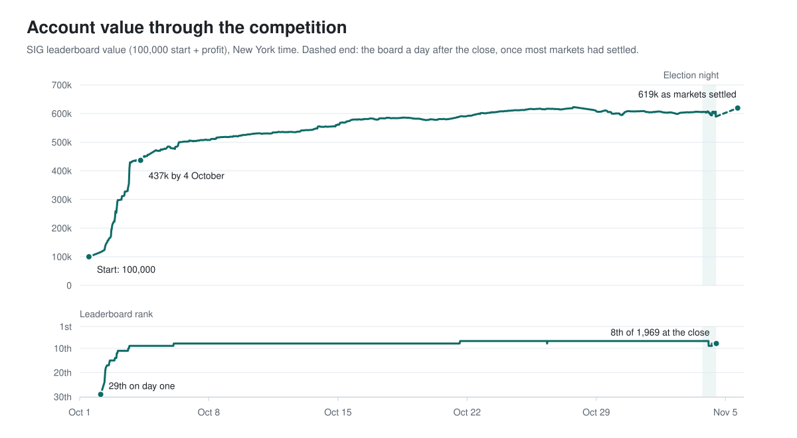
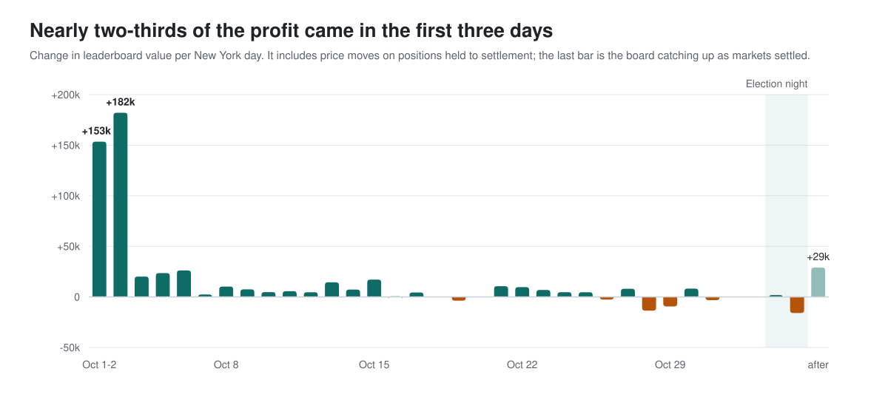

# Trading the 2026 midterms with a bot: 8th of 1,969 in the SIG Predictions Cup

From 1 October to 4 November 2026, Susquehanna (SIG) ran the **Predictions Cup**, a play-money prediction market on the
US midterm elections. I ran an automated trading bot, written in Python, for all five weeks and finished
**8th of 1,969** (on the leaderboard as `merry-coral-9766`). My 100,000 starting balance should settle at about
**628,800, a 6.3x return**.

This is the story of how it went: what worked, what broke and what I'd do differently. The code, data and strategy
details stay private.

*Standings are provisional until SIG resolves every market. A few races are still being counted (Alaska's governor
race goes to a ranked-choice count on 18 November).*

<picture>
  <source media="(prefers-color-scheme: dark)" srcset="figures/account-dark.svg">
  
</picture>

## Contents

- [The competition](#the-competition)
- [Missing the open](#missing-the-open)
- [Building the bot on day one](#building-the-bot-on-day-one)
- [Keeping it running](#keeping-it-running)
- [The long middle](#the-long-middle)
- [Safe or swing](#safe-or-swing)
- [Election night](#election-night)
- [The leaderboard isn't the score](#the-leaderboard-isnt-the-score)
- [If I did it again](#if-i-did-it-again)
- [How it was built](#how-it-was-built)

## The competition

SIG listed 237 markets on Senate, House and governor races, plus control of each chamber of Congress. Each contract
pays 1 if its outcome happens and 0 if not, so prices run from 0 to 1 and read like probabilities.

Everyone started with 100,000 SUSQies of play money. Trading ran from noon New York time on 1 October until noon on
4 November, the day after the election. The final ranking is your balance once every market settles. Automated
trading through SIG's API was allowed, and the top three won $30,000, $5,000 and $2,500.

I'm in New Zealand, so the US trading day was my night.

## Missing the open

Trading opened at 5am my time. I'd researched every race and planned to place trades through the website.
Seventeen minutes before the open, the site put up a new "agree to the Official Rules" box that needed me to accept
it, and I was asleep. I got in about six hours late.

By then the top three were each up around half a million. Those opening hours turned out to be the most profitable of
the whole competition, and I missed them.

Lesson one: do every login, terms and setup step the day before.

## Building the bot on day one

Watching the opening convinced me that trading through the website couldn't keep up, so I switched to an automated
bot on SIG's official API. A first version was running by the end of the first day, and from then on it ran around
the clock.

The bot was a market maker of sorts. It kept a price for every contract and kept orders in the book around it, so it
was there when other traders wanted to trade in a hurry. I'll leave the details there.

It worked. I went from 29th after the first day to 11th by 3 October and 9th by 4 October, with 437,000 in the
account. Nearly two-thirds of my total profit came in those first three days.

## Keeping it running

For five weeks the bot ran on my home PC. My worst days had nothing to do with trading ideas. They were the days it
wasn't running properly:

- In the first week the PC shut down for almost nine hours.
- In mid-October an automatic restart (probably Windows Update) took the bot down for eight hours overnight.
- In late October the bot froze for 24 hours while every health check said it was fine. Orders kept filling with
  nothing managing them, and my cash went to almost zero.
- The day before the election, my internet went down for four hours.

Each one led to a fix: a watchdog that restarts the bot when it stops making progress (not just when it dies), Windows
Update paused until after the election, and alerts that watch what the bot is doing rather than whether it's alive.

I also changed the bot constantly, which is risky with real positions on. Changes ran first in a test mode with the
orders faked out, and I kept 63 numbered versions of the bot, so a bad change could be rolled back in a minute.

## The long middle

<picture>
  <source media="(prefers-color-scheme: dark)" srcset="figures/daily-dark.svg">
  
</picture>

After the first week the market calmed down. Daily profit fell from six figures to a few thousand, and it stayed
there. I held 8th from 6 October and 7th from 21 October.

I used the quiet weeks for research: more than a hundred studies in a running log. Most ideas that looked good in a
quick test shrank to almost nothing when replayed strictly against what actually traded. The honest conclusion was
that there wasn't much edge left to find, which is a result too.

## Safe or swing

By late October I was about 400,000 behind third place, and trading alone wasn't going to close the gap. The only
realistic route was one big directional bet: about 270,000 on Republicans winning the Senate. It could only work if
Republicans won, which the markets put at about one in three. Two times in three, it would have left me with about
330,000.

On 30 October I decided I'd rather keep a top-10 finish than gamble it. I wrote my election-night limits down in
advance so I wouldn't be tempted in the middle of the night.

Democrats won the Senate. That bet would have lost.

## Election night

I spent much of the last two weeks preparing for the night. I built a separate program just for election night,
rehearsed it against the live market without sending orders, and wrote a runbook for everything that could go wrong.

On the night, the regular bot was switched off and the election-night program went live at 5:18pm New York time,
before the first polls closed. It ran until the market closed at noon the next day, checking every race about every
three seconds.

There turned out to be much less to do than I'd planned for. Prices on the site caught up with results quickly. Of the
14 trades the program tried overnight, 8 came back empty because the cheap offers were gone by the time the order
arrived. My biggest trade of the night was 98,355 shares of "Democrats win the House", bought at an average of
91.9 cents once the House looked decided. It paid out at 1.00, for about 7,900 of profit.

Meanwhile, one player went from about 200,000 in profit to 1.29 million overnight without making a trade: positions
they already held came in. That's the other side of the decision I made on 30 October. They passed me, and I
finished 8th.

## The leaderboard isn't the score

SIG's live leaderboard values open positions at recent trading prices, not at what they'll pay out. On election night
that made my number fall from +506,000 to +490,000 even though everything I held was winning, and for a few hours I
was 9th. A day after the close, with most markets settled, the board showed +519,000. It should end near +528,800
when the last markets settle.

If the game is scored at settlement, keep your own count of what your positions will pay.

## If I did it again

- **Be there at the open.** Clear every login, terms box and setup step the day before. The first hours were the
  richest of the competition.
- **Automate from the start.** I planned to trade through the website. The bot made the result.
- **Uptime beats cleverness.** My worst days were outages, not bad ideas. Build the watchdog first and pause
  automatic updates.
- **Cash is the constraint.** On the first night a burst of trading tied up my whole balance in 20 minutes. Every
  opportunity competes for the same cash, so money tied up in one place can't work anywhere else.
- **Test every change before it touches the market, and keep a way back.**
- **Decide your risk before the big moment.** Writing my election-night limits down early stopped me from gambling
  away a top-10 finish at 2am.
- **Trust settlement, not the scoreboard.**

## How it was built

About 15,000 lines of Python across the bot, the election-night program and a pile of research scripts, running on
my home PC in New Zealand for five weeks. On the leaderboard that came to 6,075 trades and about 29 million SUSQies
of volume.

I built it with Claude Code, Anthropic's AI coding assistant, as my coding partner. It wrote most of the code from my
direction, ran the research and backtests, and helped run things overnight, including on election night. I set the
goals and risk limits and signed off on the big decisions.

The code, data and strategy details are private.

Thanks to Susquehanna for running a great competition.
